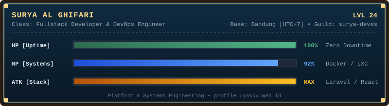
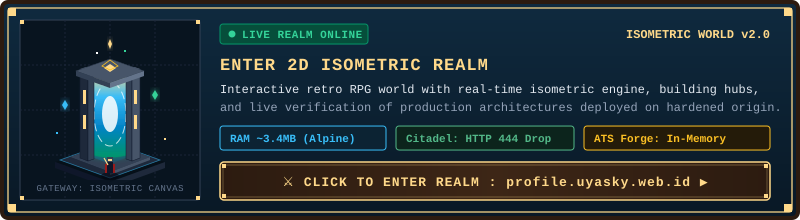

# Muhamad Surya Al Ghifari

  

  <a href="https://profile.uyasky.web.id/"><b>Portfolio</b></a> &nbsp;&bull;&nbsp;
  <a href="https://resume.uyasky.web.id/"><b>Resume Suite</b></a> &nbsp;&bull;&nbsp;
  <a href="https://github.com/surya-devss"><b>Organization</b></a> &nbsp;&bull;&nbsp;
  <a href="https://www.linkedin.com/in/muhamad-surya-al-ghifari-791625335/"><b>LinkedIn</b></a>

---

## Character Status

  

- **Focus**: Rekayasa sistem web modular berbasis bukti, orkestrasi container LXC & Docker, serta arsitektur reverse proxy zero-downtime.
- **Background**: Mahasiswa Sistem Informasi yang mendalami DevOps, backend performa tinggi (Laravel, Node.js, FastAPI), dan interface web retro modern.
- **Contact**: [m.suryaalghifari@gmail.com](mailto:m.suryaalghifari@gmail.com)

---

## Tech Stack & Equipment

<table align="center" width="100%">
  <tr>
    <td width="22%" align="center"><b>Languages</b></td>
    <td>
      
    </td>
  </tr>
  <tr>
    <td width="22%" align="center"><b>Frontend</b></td>
    <td>
      
    </td>
  </tr>
  <tr>
    <td width="22%" align="center"><b>Backend</b></td>
    <td>
      
    </td>
  </tr>
  <tr>
    <td width="22%" align="center"><b>Databases</b></td>
    <td>
      
    </td>
  </tr>
  <tr>
    <td width="22%" align="center"><b>DevOps & Tools</b></td>
    <td>
      
    </td>
  </tr>
</table>

---

## Production Realm Gateway

  

---

  
<i>May your latency be low and your uptime be eternal.</i>

  

    <a href="https://profile.uyasky.web.id/">profile.uyasky.web.id</a> &nbsp;&bull;&nbsp; 
    <a href="mailto:m.suryaalghifari@gmail.com">m.suryaalghifari@gmail.com</a>
  

